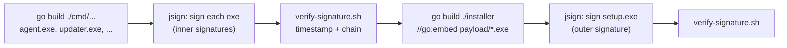

# Test-ExecutableSignature.ps1

Checks **only the code signature and certificate** of a Windows executable and, for every problem, says **who has to act and what to do**. The file is never executed.

## Why a signature check

A file's signature is fixed when it's signed. It's part of the file the publisher ships. If the timestamp is missing, the chain is incomplete, the certificate is untrusted or revoked, or the file was changed after signing, **only the publisher can fix it**: by signing again, adding a timestamp, embedding the chain or using another CA. Nothing a user does on their own PC makes a bad signature good. Installing an unknown root certificate to silence the warning makes things worse.

So this script:
- tells the **publisher** exactly what to change in their signing or release process

Publishers can run it, on a Windows build agent after signing, as a release gate: exit code `2` fails the build.

## Contents

- [Why a signature check](#why-a-separate-signature-check)
- [Quick start](#quick-start)
- [Parameters](#parameters)
- [Output, actions and exit codes](#output-actions-and-exit-codes)
- [Findings and actions](#findings-and-actions)
- [How each check works](#how-each-check-works)
  - [Signature, certificate and timestamp](#signature-certificate-and-timestamp)
  - [Checks added in this script](#checks-added-in-this-script)
- [Worked example](#worked-example)
- [Runtime impact of a missing timestamp](#runtime-impact-of-a-missing-timestamp)
  - [What happens after expiry](#what-happens-after-expiry)
  - [Revocation: a bigger risk than expiry](#revocation-a-bigger-risk-than-expiry)
  - [Timeline for an untimestamped file](#timeline-for-an-untimestamped-file)
  - [What to do](#what-to-do)
- [Fixing it at the source: jsign on a GitLab Linux runner](#fixing-it-at-the-source-jsign-on-a-gitlab-linux-runner)
  - [1. Build a signing image once](#1-build-a-signing-image-once)
  - [2. Pipeline job](#2-pipeline-job)
  - [3. Check the TSA before signing](#3-check-the-tsa-before-signing)
  - [4. Verify the result before publishing](#4-verify-the-result-before-publishing)
  - [5. Sign with a CA the users trust](#5-sign-with-a-ca-the-users-trust)
  - [When the TSA URL is not reachable](#when-the-tsa-url-is-not-reachable)
  - [Maven: signing several executables embedded in a Go installer](#maven-signing-several-executables-embedded-in-a-go-installer)
- [Limitations](#limitations)

## Quick start

```powershell
powershell -ExecutionPolicy Bypass -File .\Test-ExecutableSignature.ps1 -Path "$env:USERPROFILE\Downloads\setup.exe"
```

With the expected publisher, and a report to send to the publisher:

```powershell
.\Test-ExecutableSignature.ps1 .\setup.exe -ExpectedPublisher "Contoso Ltd" -ReportPath .\signature-report.json
```

Works in Windows PowerShell 5.1 and PowerShell 7, without Administrator rights. The revocation check needs internet access to the certificate authority.

## Parameters

| Parameter | Purpose |
|---|---|
| `-Path` (required) | The file to check (`.exe`, `.dll`, `.msi`, `.sys`, ...). |
| `-ExpectedPublisher` | Text the signer name must contain, e.g. `"Mozilla Corporation"`. A mismatch is a FAIL. |
| `-SkipRevocationCheck` | Don't contact the certificate authority (offline use). |
| `-ExpiryWarningDays` | For signatures without a timestamp, call the expiry "SOON" when it's within this many days. Default `90`. |
| `-ReportPath` | Save the findings and actions to a `.json` or `.csv` file. |

## Output, actions and exit codes

Each finding has a level, and every WARN or FAIL is followed by one or more **actions**, each addressed to whoever can carry it out:

```
  [WARN] Signature has no timestamp. It stops being valid when the certificate expires on 2027-08-17 (278 days).
         -> Publisher: Add a timestamp now without re-signing: jsign timestamp --tsaurl <TSA> --tsmode RFC3161 file.exe ...
         -> You: It works today. After 2027-08-17, Smart App Control blocks it and signature checks fail; ...
```

| Level | Meaning |
|---|---|
| `PASS` | The check succeeded. |
| `INFO` | A fact worth knowing. It may carry an optional action. |
| `WARN` | Something to fix or review. |
| `FAIL` | A serious problem. Don't run the file until it's fixed. |

At the end, the **Summary** lists the actions again, grouped by owner, failures first, without duplicates. That makes it a ready-made to-do list per person. With `-ReportPath`, the JSON report holds each finding with its `Actions` (owner and text), and the CSV report has an `Actions` column (`Owner: text | Owner: text`).

| Exit code | Verdict | Condition |
|---|---|---|
| `0` | No problems | Only PASS and INFO |
| `1` | Review warnings | At least one WARN, no FAIL |
| `2` | Not acceptable / do not run | At least one FAIL |

## Findings and actions

Every WARN and FAIL the script can report, with the action it prints for each owner:

| Finding | Level | Publisher should | You should |
|---|---|---|---|
| File not signed | WARN | Sign with a code-signing certificate and a timestamp (`jsign --alg SHA-256 --tsaurl <TSA> --tsmode RFC3161 --certfile <chain>`) | Ask for a signed build, or compare the SHA-256 with a hash the publisher publishes on an HTTPS page |
| Signature broken (file changed after signing) | FAIL | If the official download fails too: find out how it was altered (build step, CDN, compromise), rebuild and re-sign | Delete it and download again from the official site |
| Signature not trusted (overall status) | FAIL | See the certificate and chain rows below | Don't run it until those are fixed |
| Certificate issued less than 30 days ago | WARN | Nothing to fix; reputation rebuilds after a renewal (EV certificates shorten this) | Confirm the hash or signer through a channel you already trust |
| Certificate not issued for code signing | FAIL | Use a certificate with the Code Signing EKU | Don't run it |
| Lifetime Signing EKU | WARN | Use a certificate without it, or plan to re-sign before it expires | - |
| No timestamp, certificate still valid | WARN | Add one now with `jsign timestamp` or `signtool timestamp`, and add `--tsaurl` and `--tsmode RFC3161` to the pipeline | It works until the expiry date shown; ask for a timestamped build |
| No timestamp, certificate expired | FAIL | Re-sign with a valid certificate and a timestamp, and release again | Don't run it; ask for a newly signed build |
| Only a legacy Authenticode timestamp | INFO | Optional: switch to RFC 3161 | - |
| Certificate expired but signature timestamped | INFO | Renew the certificate before the next release | - |
| SHA-1-only signature | WARN | Sign with SHA-256 | - |
| Certificate revoked | FAIL | Find the cause; get a new certificate; re-sign every supported release with a timestamp | Don't run it; delete it |
| Self-signed certificate | FAIL | Use a certificate from a public code-signing CA | Don't run it, and don't install the certificate |
| Untrusted root CA | FAIL | External users: use a public CA. Company PCs only: IT deploys the root (Group Policy or Intune) | Don't install unknown roots yourself; ask the publisher or IT |
| Incomplete chain (issuer missing) | FAIL | Embed the full chain (`--certfile chain.pem`); for an internal CA, users also need its root | Ask for a build with the full chain, or ask IT to deploy the issuing CA |
| Only the signer certificate embedded (chain works here) | WARN | Pass the full chain to the signing tool | - |
| Revocation can't be checked | WARN | Internal CA: make its CRL/OCSP addresses reachable | Run again online; check the proxy allows the CA's addresses |
| CA certificate outside its validity period | WARN | Renew it and re-sign with a timestamp | - |
| Signer doesn't match `-ExpectedPublisher` | FAIL | - | Don't run it; it may be impersonating that publisher |
| `-ExpectedPublisher` given but file not signed | FAIL | - | Don't run it |
| Signer differs from the file's CompanyName | WARN | Make CompanyName match the certificate's organisation | Check the signer really belongs to that company |

## How each check works

### Signature, certificate and timestamp

**Authenticode status.** `Get-AuthenticodeSignature` asks Windows (`WinVerifyTrust`) whether the signature is valid:

| Status | Level | Meaning |
|---|---|---|
| `Valid` | PASS | Signed, untampered, chains to a trusted root. |
| `NotSigned` | WARN | No signature, so the author can't be verified. Many open-source tools are unsigned, so this alone isn't a failure. |
| `HashMismatch` | FAIL | The file was changed after it was signed. |
| `NotTrusted` / other | FAIL | The certificate isn't trusted on this PC. |

It also reports whether the signature is **embedded** (Authenticode) or comes from a **Windows catalog file** (Catalog, used for OS files), and whether the file is an OS binary.

**Certificate details.** The signer, subject, issuer, validity dates and thumbprint are printed. Extra checks:
- **New certificate.** A certificate issued less than 30 days ago is a WARN. Attackers sometimes buy fresh certificates for a campaign.
- **EV certificate.** If the certificate carries policy OID `2.23.140.1.3`, it's an Extended Validation code-signing certificate. The CA verified the company's identity strictly. Reported as PASS.
- **Timestamp.** A timestamp from a trusted timestamp authority (TSA) proves *when* the file was signed, so the signature stays valid after the certificate expires. No timestamp is a WARN. No timestamp *and* an expired certificate is a FAIL. See [How the timestamp is detected](#how-the-timestamp-is-detected) and [Runtime impact of a missing timestamp](#runtime-impact-of-a-missing-timestamp).

#### How the timestamp is detected

Configuring a TSA URL in the signing tool isn't enough. What counts is whether a timestamp **ended up in the file**. The signing tool sends the signature's hash to the TSA, and the TSA's signed reply is stored inside the file's signature as an *unsigned attribute*. If that request never happened or failed, there's no timestamp, whatever was configured.

The script checks in two ways:

1. **Windows' view.** `Get-AuthenticodeSignature` returns `TimeStamperCertificate`. Windows only fills this in after the signature validates, so when the chain fails (e.g. an untrusted or missing issuer) it can be empty even though a timestamp exists.
2. **Reading the file directly.** `Get-EmbeddedSignatureInfo` reads the PE *certificate table* (data directory entry 4), takes the PKCS#7 blob from the `WIN_CERTIFICATE` structure, and decodes it with .NET `SignedCms`. It then looks at the signer's unsigned attributes:

| Where | OID | Meaning |
|---|---|---|
| Unsigned attribute | `1.3.6.1.4.1.311.3.3.1` | RFC 3161 timestamp token (`signtool /tr`). The TSA name and signing time are read from it. |
| Counter-signature | `1.2.840.113549.1.9.6` | Legacy Authenticode timestamp (`signtool /t`). |
| Unsigned attribute | `1.3.6.1.4.1.311.2.4.1` | Nested signature (dual signing, e.g. SHA-1 plus SHA-256). Counted and reported. |

If either way finds a timestamp, the result is a PASS that names the TSA and the signing time in UTC. If only the direct read finds it, an INFO line says Windows didn't report it because validation failed. If the signature contains neither kind of timestamp, the WARN says the signing tool didn't add one. With signtool, that means checking that `/tr <TSA url> /td sha256` was passed and the TSA request succeeded. Other tools, such as `osslsigncode` without `-ts`, or a build pipeline that signs in a different step, can also leave it out.

The same direct read reports how many certificates are embedded in the signature. A signature that includes only the leaf certificate depends on the PC already having the issuing CA's certificate. Without it, the chain is incomplete.

**Chain and revocation.** The script builds the certificate chain itself with `X509Chain`:
- `RevocationMode = Online` and `RevocationFlag = EntireChain` make Windows contact each CA's CRL or OCSP server to check whether any certificate in the chain has been revoked. The timeout is 15 seconds.
- The Code Signing usage (OID `1.3.6.1.5.5.7.3.3`) is required.
- If the signature is timestamped, certificate expiry is ignored, matching how Windows treats timestamped signatures.

The extra build is needed because `Get-AuthenticodeSignature` doesn't always check revocation. A revoked certificate is the strongest warning sign there is: the CA has withdrawn it, usually because the key was stolen or used to sign malware.

| Chain problem | Level |
|---|---|
| Revoked | FAIL |
| Untrusted root (often self-signed) | FAIL |
| Incomplete chain (issuer certificate not installed) | FAIL |
| Not valid for code signing | FAIL |
| Revocation server unreachable | WARN |

**Publisher match.**
- With `-ExpectedPublisher`, the signer name or subject must contain the given text, or it's a FAIL.
- The signer is always compared with the CompanyName from version info. Both names are normalised first by stripping "Inc", "Ltd", "Corporation" etc. and punctuation. A mismatch is a WARN, because malware often copies a well-known CompanyName that the real signer doesn't match.

### Checks added in this script

Besides everything above, which is shared with `Test-ExecutableSafety.ps1`, this script also checks:

- **Days to expiry without a timestamp.** It shows the date the signature stops being valid and the days left, marked **SOON** within `-ExpiryWarningDays`.
- **Lifetime Signing EKU** (`1.3.6.1.4.1.311.10.3.13`). Such signatures expire with the certificate even when timestamped.
- **Code Signing EKU** missing from the certificate.
- **SHA-1-only signatures**, which Windows no longer trusts for new signatures.
- **Self-signed certificates**, told apart from certificates issued by an untrusted CA.
- **The full chain** printed as `signer -> intermediate -> root`.
- **Revocation noise removed.** If the chain is incomplete or untrusted, revocation can't be checked at all. That isn't reported as a separate warning.

## Worked example

A vendor's client launcher signed by an internal test CA (names anonymised). The output is shortened:

```
== Signature ==
  [FAIL] Signature is not trusted (UnknownError): A certificate chain could not be built to a trusted root authority
         -> You: Do not run it until the certificate problems in this report are fixed by the publisher (or IT, for an internal CA).

== Timestamp ==
  [WARN] Signature has no timestamp. It stops being valid when the certificate expires on 2027-08-17 (278 days).
         The signature block contains no RFC 3161 or legacy timestamp, so the signing tool did not add one.
         -> Publisher: Add a timestamp now without re-signing: jsign timestamp --tsaurl <TSA> --tsmode RFC3161 file.exe ...
         -> You: It works today. After 2027-08-17, Smart App Control blocks it and signature checks fail; ...
  [INFO] Embedded signature: sha256 digest, 1 certificate(s) included, 0 nested signature(s).

== Certificate chain ==
  [INFO] Chain: Example Client Launcher
  [FAIL] Certificate chain is incomplete: the issuer 'Example Corp Internal CA UAT 1' is not on this PC and not in the signature.
         -> Publisher: Embed the full chain (signer + intermediates) when signing: jsign --certfile chain.pem. If the CA is internal, users also need its root.
         -> You: Ask the publisher for a build that includes the full chain, or ask IT to deploy the issuing CA.

== Publisher identity ==
  [WARN] Signer 'Example Client Launcher' differs from the CompanyName in the file 'Example Corp'.
         -> Publisher: Make the CompanyName in the version resource match the organisation in the certificate ...

  VERDICT: SIGNATURE NOT ACCEPTABLE. The publisher must fix the failures above before this file should be run.
```

What it means:
- **Publisher:** three changes to the signing step: add `--certfile` with the full chain, add `--tsaurl` and `--tsmode RFC3161`, and sign production releases with a production CA (or a public CA if the file goes to external users). The existing file can be timestamped with `jsign timestamp` as long as the certificate is still valid.
- **You:** don't run it, and don't install the internal CA yourself. Send the report to the vendor, or ask your IT department if the vendor says the CA is meant to be deployed on company PCs.

## Runtime impact of a missing timestamp

**While the signing certificate is valid, a missing timestamp makes no difference.** It only matters once the certificate is past its expiry date (`NotAfter`), or if the certificate is revoked.

Without a timestamp, Windows checks the signature against **today's date**. After expiry it finds an expired certificate and nothing proving the file was signed while the certificate was valid. The signature then counts as **invalid** (`CERT_E_EXPIRED`, `0x800B0101`).

The file itself isn't damaged. Windows treats it like an unsigned file, so whether it still runs depends on what checks it.

### What happens after expiry

| Component | Effect when the signature is invalid |
|---|---|
| **Normal launch** (double-click, `CreateProcess`) | **Still runs.** Windows doesn't require a valid signature to start an ordinary exe. |
| **SmartScreen** (files with Mark of the Web) | Treated as an unknown publisher. Reputation earned by the certificate no longer helps, so "Windows protected your PC" is more likely. Users can still click *Run anyway* unless policy forbids it. |
| **UAC prompt** (installers and tools needing admin) | Yellow **"Publisher: Unknown"** prompt instead of the blue verified-publisher prompt. Elevation is still allowed by default. |
| **UAC "Only elevate executables that are signed and validated"** (registry `HKLM\SOFTWARE\Microsoft\Windows\CurrentVersion\Policies\System\ValidateAdminCodeSignatures = 1`) | **Blocked from elevating.** Off by default; some managed company builds turn it on. |
| **Smart App Control** | **Blocked**, unless Microsoft's cloud already rates the file as safe. It needs a valid signature or good reputation. |
| **App Control for Business (WDAC)** | **Usually still allowed.** By default, Code Integrity doesn't reject a signature because its certificate expired, so publisher rules keep matching. See the exceptions below. |
| **AppLocker publisher rules** | Generally keep matching the publisher name. Test this if your environment relies on it. |
| **Antivirus / EDR** | An invalid signature raises the file's risk score. Rules like "invalid signature running from a user folder" may alert on it or block it. |
| **Your own install or update code** | Anything that checks signatures (`WinVerifyTrust`, `Get-AuthenticodeSignature`, an updater confirming a download is genuine) **fails.** Auto-updates can stop working on the expiry date. |
| **Explorer → Properties → Digital Signatures** | "This digital signature is not valid." |
| **`Test-ExecutableSignature.ps1`** | FAIL: "Certificate has expired and there is no timestamp." |

WDAC *does* reject the file when:
- The policy enables rule option **20, `Enabled:Revoked Expired As Unsigned`**. Files signed with a revoked certificate, or with an expired certificate that carries the *Lifetime Signing* EKU (`1.3.6.1.4.1.311.10.3.13`), are then treated as unsigned.
- The policy has no publisher rule for the signer at all, and only allows files by hash, by managed installer, or by Microsoft's reputation service (ISG).

A certificate with the Lifetime Signing EKU expires its signatures with the certificate **even when they are timestamped**. Check its EKUs (the script shows the certificate; `certutil -dump` or Explorer's certificate details list them). Code-signing certificates normally carry only Code Signing (`1.3.6.1.5.5.7.3.3`).

### Revocation: a bigger risk than expiry

If the CA **revokes** the signing certificate, for example after a key compromise or when the certificate is retired:

| | Effect |
|---|---|
| **With a timestamp** | Files signed *before* the revocation date stay valid. Only files signed after it become invalid. |
| **Without a timestamp** | **Every file ever signed with that certificate becomes invalid at once.** Windows can't tell which files were signed before the problem. |

Smart App Control, SmartScreen and EDR react straight away, and WDAC does too if option 20 is enabled. This can happen at any time, not just on the expiry date.

### Timeline for an untimestamped file

| Period | What happens |
|---|---|
| Signing date until the certificate's `NotAfter` | No difference from a timestamped file, as long as the certificate chains to a trusted root. |
| After `NotAfter` | Smart App Control blocks it. Signature checks in install and update code fail. UAC shows "Unknown publisher". SmartScreen and EDR treat it as unsigned. Under a WDAC publisher rule, without option 20, it most likely still runs. |
| Any time the certificate is revoked | All of the above, immediately, for every file signed with it. |

### What to do

- **Before the certificate expires:** add a timestamp without re-signing, using `jsign timestamp ...` (jsign 7.0+) or `signtool timestamp /tr <TSA url> /td sha256 <file>`. Then check it with `verify-signature.sh` or `Test-ExecutableSignature.ps1`.
- **After it has expired:** a timestamp can no longer help, because it would prove signing happened after expiry. Re-sign the file with a valid certificate and a timestamp, and ship it again.
- **Check ahead of time:** look for an expiry date on untimestamped release files in your build or release checklist. To see the effect, set a test VM's clock past `NotAfter` and run `Test-ExecutableSignature.ps1`, `signtool verify /pa /v`, or the installer itself.

## Fixing it at the source: jsign on a GitLab Linux runner

The worked example had two signing faults: **no timestamp** and **only the signer's certificate embedded**. Both come from how the file was signed. This section shows how to sign with [jsign](https://ebourg.github.io/jsign/) on a GitLab Linux runner so that neither can happen, and so the pipeline fails if they do.

Facts from the jsign documentation (version 7.6) that matter here:

| Option | What to know |
|---|---|
| `--tsaurl <URL>[,<URL>...]` | Address of the timestamp authority (TSA). Several comma-separated URLs are tried in order as fallbacks. **Always set it explicitly.** The Maven plugin stopped timestamping by default in 7.6, so an upgrade can silently drop timestamps. |
| `--tsmode RFC3161\|Authenticode` | Defaults to **Authenticode** (the older format). Set `RFC3161` explicitly; some TSAs only speak RFC 3161. |
| `--tsretries` / `--tsretrywait` | Defaults to 3 retries, 10 seconds apart. |
| `--certfile <file>` | The PKCS#7 certificate chain (PEM, or DER `.p7b`/`.spc`). Required when the key store holds only the key, as cloud key stores and HSMs often do. If it holds only the signer certificate, jsign tries to download the intermediates from the certificate's AIA URL, which fails on an isolated runner. **Supply the full chain: signer plus intermediates.** |
| `--proxyUrl` / `--proxyUser` / `--proxyPass` | HTTP proxy for TSA and key store traffic. |
| `jsign timestamp ...` | Command (jsign 7.0+) that adds a timestamp to an already-signed file without signing it again. |

### 1. Build a signing image once

Bake jsign into an image in your own registry instead of downloading it in every job. Pin the version and check its hash; get the SHA-256 from the [releases page](https://github.com/ebourg/jsign/releases).

```dockerfile
# ci/jsign.Dockerfile
FROM eclipse-temurin:21-jre
ARG JSIGN_VERSION=7.6
ARG JSIGN_SHA256=<sha256-of-jsign-7.6.jar>

RUN apt-get update \
 && apt-get install -y --no-install-recommends curl ca-certificates openssl osslsigncode \
 && rm -rf /var/lib/apt/lists/* \
 && curl -fsSL -o /opt/jsign.jar \
      "https://github.com/ebourg/jsign/releases/download/${JSIGN_VERSION}/jsign-${JSIGN_VERSION}.jar" \
 && echo "${JSIGN_SHA256}  /opt/jsign.jar" | sha256sum -c - \
 && printf '#!/bin/sh\nexec java $JAVA_OPTS -jar /opt/jsign.jar "$@"\n' > /usr/local/bin/jsign \
 && chmod +x /usr/local/bin/jsign
```

`openssl` and `osslsigncode` are included for the reachability check and the verification step below. If your build machines trust a corporate CA (for an internal TSA, or a proxy that inspects TLS), add its root to the Java trust store here, e.g. `keytool -importcert -cacerts -noprompt -alias corp-root -file corp-root.pem`.

### 2. Pipeline job

```yaml
# .gitlab-ci.yml (sign stage)
sign-exe:
  stage: sign
  image: $CI_REGISTRY_IMAGE/jsign:7.6
  needs: [build-exe]
  variables:
    # Primary TSA first, fallbacks after. Use your internal TSA if you have one.
    TSA_URLS: "http://timestamp.digicert.com,http://timestamp.sectigo.com"
    EXE: dist/app.exe
  script:
    - sh ci/check-tsa.sh "$TSA_URLS"          # fail fast if no TSA answers
    - jsign
        --storetype "$SIGN_STORETYPE" --keystore "$SIGN_KEYSTORE"
        --storepass "$SIGN_STOREPASS" --alias "$SIGN_ALIAS"
        --certfile "$SIGN_CHAIN_PEM"
        --alg SHA-256
        --tsaurl "$TSA_URLS" --tsmode RFC3161 --tsretries 5 --tsretrywait 15
        ${PROXY_URL:+--proxyUrl "$PROXY_URL"}
        "$EXE"
    - sh ci/verify-signature.sh "$EXE"        # fail if timestamp or chain is missing
  artifacts:
    paths: [dist/app.exe]
```

- `SIGN_*` are protected, masked CI/CD variables. `SIGN_CHAIN_PEM` is a **File**-type variable, so GitLab gives the job a path to a PEM file with the signer and intermediate certificates.
- `SIGN_STORETYPE` / `SIGN_KEYSTORE` depend on where the key lives, e.g. `AZUREKEYVAULT`, `PKCS11`, `DIGICERTONE`, `GOOGLECLOUD`, `AWS`. See the jsign docs for each store's values. The [Windows Code Signing Playbook](docs/Windows%20Code%20Signing%20Playbook.md) has an Azure Key Vault example.
- `PROXY_URL` is optional. When it's set, jsign uses it (see [below](#when-the-tsa-url-is-not-reachable)).
- Sign every file in **one** `jsign` call (`jsign ... a.exe b.dll c.msi`) rather than one call per file. It's faster, and it makes fewer requests to public TSAs, which may throttle.

### 3. Check the TSA before signing

`ci/check-tsa.sh` sends a real RFC 3161 request to each TSA and stops the job if none of them grants it. This turns a network problem into a clear message *before* anything is signed.

```sh
#!/bin/sh
# Usage: check-tsa.sh "http://tsa1,http://tsa2"
set -u
ok=""
for url in $(echo "$1" | tr ',' ' '); do
  head -c 32 /dev/urandom > /tmp/tsa-probe.bin
  openssl ts -query -data /tmp/tsa-probe.bin -sha256 -cert -out /tmp/tsa-probe.tsq
  if curl -fsS --max-time 15 ${PROXY_URL:+--proxy "$PROXY_URL"} \
       -H "Content-Type: application/timestamp-query" \
       --data-binary @/tmp/tsa-probe.tsq -o /tmp/tsa-probe.tsr "$url" \
     && openssl ts -reply -in /tmp/tsa-probe.tsr -text | grep -q 'Status: Granted'; then
    echo "TSA OK:     $url"; ok=1
  else
    echo "TSA FAILED: $url"
  fi
done
[ -n "$ok" ] || { echo "No timestamp authority reachable - refusing to sign."; exit 1; }
```

The request contains only the hash of 32 random bytes, so nothing about your build is sent.

### 4. Verify the result before publishing

`ci/verify-signature.sh` reads the signature that ended up in the file and fails the job if there's no timestamp or the chain wasn't embedded. These are the same two checks `Test-ExecutableSignature.ps1` makes on Windows.

```sh
#!/bin/sh
# Usage: verify-signature.sh <file.exe> [<file2.exe> ...]
set -eu
[ "$#" -gt 0 ] || { echo "No files to verify"; exit 1; }
for f in "$@"; do
  osslsigncode extract-signature -pem -in "$f" -out /tmp/sig.pem \
    || { echo "FAIL: $f is not signed"; exit 1; }

  if openssl pkcs7 -in /tmp/sig.pem -print | grep -Eq '1\.3\.6\.1\.4\.1\.311\.3\.3\.1|countersignature'; then
    echo "OK:   $f is timestamped"
  else
    echo "FAIL: $f has no timestamp"; exit 1
  fi

  n=$(openssl pkcs7 -in /tmp/sig.pem -print_certs | grep -c '^subject=')
  if [ "$n" -ge 2 ]; then
    echo "OK:   $f has $n certificates embedded"
  else
    echo "FAIL: $f has only $n certificate embedded - pass the full chain with --certfile"; exit 1
  fi
done
```

`1.3.6.1.4.1.311.3.3.1` is the RFC 3161 timestamp, and `countersignature` is the older Authenticode timestamp. Tested against real signatures: Git for Windows (RFC 3161, 4 certificates), Chrome (Authenticode, 5 certificates), and the worked example's file (no timestamp, 1 certificate, correctly rejected).

### 5. Sign with a CA the users trust

A timestamp and a full chain don't help if the root CA isn't trusted on the PCs that run the file:

| Who runs the file | Sign with |
|---|---|
| Only company-managed PCs | The **production** internal CA, with its root deployed to those PCs (Group Policy or Intune). Never a UAT/test CA for a production release. |
| Customers or external users | A certificate from a public code-signing CA (OV or EV), trusted on every Windows PC without setup. |

If you use an internal TSA, the same applies to it: Windows only accepts the timestamp if the TSA's certificate chains to a root the user's PC trusts.

### When the TSA URL is not reachable

Timestamping is the only step in signing that needs to reach a server outside your network. When it fails, check these, roughly in order of how often each is the cause:

| Watch for | Why it happens | What to do |
|---|---|---|
| **Outbound port 80 blocked** | Most public TSAs (`http://timestamp.digicert.com`, `http://timestamp.sectigo.com`) use plain HTTP. Many runner networks only allow 443. HTTP is fine here: the TSA's reply is signed, so it can't be tampered with in transit. | Allow outbound HTTP to the TSA hosts, or use a TSA that offers HTTPS. |
| **Java ignores the proxy variables** | GitLab runners often set `HTTP_PROXY` / `HTTPS_PROXY` / `NO_PROXY`. `curl` uses them; **Java, and so jsign, does not**. The pre-flight check can pass while jsign then fails. | Pass `--proxyUrl` (and `--proxyUser`/`--proxyPass` if needed), or set `JAVA_TOOL_OPTIONS="-Dhttp.proxyHost=... -Dhttp.proxyPort=... -Dhttps.proxyHost=... -Dhttps.proxyPort=..."`. Exclude internal hosts (e.g. an internal key store) with `-Dhttp.nonProxyHosts="*.corp.example\|localhost"`, or `--nonProxyHosts` from jsign 8.0. |
| **TLS inspection on an HTTPS TSA** | A corporate proxy re-signs HTTPS traffic with its own CA, which Java's trust store doesn't know: `PKIX path building failed`. | Add the proxy's root CA to the image's Java trust store (`keytool -importcert -cacerts ...`), or use the HTTP TSA URL. |
| **Wrong `--tsmode`** | jsign defaults to Authenticode. A TSA that only speaks RFC 3161 rejects the request, which looks like a network error. | Always pass `--tsmode RFC3161`. The pre-flight check also sends RFC 3161. |
| **DNS** | Isolated runners may not resolve public names. | `getent hosts timestamp.digicert.com` in the job shows it straight away. |
| **Throttling** | Public TSAs limit bursts of requests, for example many parallel jobs each signing one file. | Sign all files in one jsign call, keep `--tsretries`/`--tsretrywait`, and list a second TSA as a fallback. |
| **Job timeout** | Each failing URL costs up to `tsretries × tsretrywait` seconds (5 × 15 s = 75 s above) before the next fallback is tried. | Size the job's `timeout:` for that, or lower the retries when you have several fallback URLs. |
| **Internal TSA not trusted by clients** | The request succeeds, but Windows on users' PCs doesn't trust the TSA's certificate, so the timestamp is ignored. | Use a public TSA for externally distributed files, or deploy the TSA's root along with your code-signing root. |

**Never fall back to signing without a timestamp.** That file works until the signing certificate expires (usually one to three years) and then shows as invalid on every PC. If no TSA is reachable, let the job fail. If the file is already signed and only the timestamp is missing, a later job can add it without re-signing, as long as the signing certificate is still valid:

```sh
jsign timestamp --tsaurl "$TSA_URLS" --tsmode RFC3161 ${PROXY_URL:+--proxyUrl "$PROXY_URL"} dist/app.exe
sh ci/verify-signature.sh dist/app.exe
```

### Maven: signing several executables embedded in a Go installer

This setup builds several Windows executables, signs them, embeds them in a Go installer with `go:embed`, and then signs the installer itself. That gives two layers of signatures:



- **Inner signatures** stay with each executable after the installer writes it to disk. Windows App Control, Smart App Control and Defender check them every time those programs run, long after the installer is gone.
- **The outer signature** covers the whole installer, including the embedded bytes, so it also protects the payload during download.
- **The order is fixed: inner first, outer last.** `go:embed` copies the files' bytes at build time, so signing them after `go build` changes nothing inside the installer. The installer must be signed last, because rebuilding it produces a new, unsigned file. Never modify a file after signing it (e.g. UPX compression or resource editing), because that breaks its signature.

#### Project layout

```text
app/
├── pom.xml
├── go.mod
├── cmd/
│   ├── agent/main.go          # each becomes a Windows .exe
│   └── updater/main.go
├── installer/
│   ├── main.go                # //go:embed payload/*.exe
│   └── payload/               # build output, git-ignored
└── ci/
    ├── settings.xml
    ├── check-tsa.sh
    └── verify-signature.sh
```

`go:embed` can only embed files inside the package's own directory or its subdirectories (no `..` paths). The executables are therefore built straight into `installer/payload/`, which is listed in `.gitignore`.

#### Facts about the jsign Maven plugin

From the plugin source (`JsignMojo.java`) and the docs:

| Item | Detail |
|---|---|
| Coordinates | `net.jsign:jsign-maven-plugin:7.6`, goal `sign`, bound to `package` by default |
| Files | `<file>` for one file, or `<fileset>` (a standard Maven FileSet: `directory`, `includes`, `excludes`) to sign many in one execution |
| Names | Same as the CLI long options, except the digest is **`<algorithm>`** (default `SHA-256`). Also `<storetype>`, `<keystore>`, `<alias>`, `<storepass>`, `<keypass>`, `<certfile>`, `<tsaurl>`, `<tsmode>`, `<tsretries>` (3), `<tsretrywait>` (10), `<name>`, `<url>`, `<replace>`, `<skip>` |
| Timestamp | Since 7.6 the Maven plugin **no longer timestamps by default**. Always set `<tsaurl>` and `<tsmode>RFC3161</tsmode>`; the verification step fails the build if no timestamp was added. |
| Passwords | `<storepass>` / `<keypass>` accept plain text, a Maven-encrypted `{...}` value, or **`mvn:<server-id>`**, which reads the password of that `<server>` in `settings.xml` |
| Proxy | **No proxy parameters.** The plugin uses the proxy from Maven's `settings.xml` (`<proxyId>` picks one; otherwise the first active http/https proxy), including its `nonProxyHosts`, user and password. This avoids the problem of Java ignoring `HTTP_PROXY`. |

#### pom.xml

Plugins bound to the **same phase** run in the order they're declared in the POM, so each step gets its own phase and `jsign` is declared before `exec`:

| Phase | Plugin | Step |
|---|---|---|
| `clean` | clean | Empty `installer/payload/`, so a stale unsigned exe can never be embedded |
| `initialize` | exec | `check-tsa.sh`: fail fast if no TSA answers |
| `compile` | exec | `go build` all `./cmd/...` into `installer/payload/` |
| `prepare-package` | jsign | Sign every exe in `installer/payload/` |
| `package` | exec | Verify the payload signatures, then `go build` the installer |
| `verify` | jsign, then exec | Sign `setup.exe`, then verify it |

Signing is off by default (`signing.skip=true`), so developers can build without keys. The `ci-signing` profile turns it on when the `CI` variable that GitLab sets is present.

```xml
<project xmlns="http://maven.apache.org/POM/4.0.0">
  <modelVersion>4.0.0</modelVersion>
  <groupId>com.example</groupId>
  <artifactId>app-installer</artifactId>
  <version>1.4.0</version>
  <packaging>pom</packaging>

  <properties>
    <payload.dir>${project.basedir}/installer/payload</payload.dir>
    <dist.dir>${project.build.directory}/dist</dist.dir>
    <installer.exe>${dist.dir}/setup-${project.version}.exe</installer.exe>
    <tsa.urls>http://timestamp.digicert.com,http://timestamp.sectigo.com</tsa.urls>
    <signing.skip>true</signing.skip>
  </properties>

  <profiles>
    <profile>
      <id>ci-signing</id>
      <activation><property><name>env.CI</name></property></activation>
      <properties><signing.skip>false</signing.skip></properties>
    </profile>
  </profiles>

  <build>
    <plugins>
      <!-- mvn clean also empties the payload folder -->
      <plugin>
        <artifactId>maven-clean-plugin</artifactId>
        <configuration>
          <filesets>
            <fileset>
              <directory>${payload.dir}</directory>
              <includes><include>*.exe</include><include>*.dll</include></includes>
            </fileset>
          </filesets>
        </configuration>
      </plugin>

      <!-- Declared BEFORE exec so that, in the verify phase, signing runs before checking -->
      <plugin>
        <groupId>net.jsign</groupId>
        <artifactId>jsign-maven-plugin</artifactId>
        <version>7.6</version>
        <configuration>
          <skip>${signing.skip}</skip>
          <storetype>${env.SIGN_STORETYPE}</storetype>
          <keystore>${env.SIGN_KEYSTORE}</keystore>
          <alias>${env.SIGN_ALIAS}</alias>
          <storepass>mvn:code-signing</storepass>       <!-- server id in settings.xml -->
          <certfile>${env.SIGN_CHAIN_PEM}</certfile>    <!-- signer + intermediates -->
          <algorithm>SHA-256</algorithm>
          <tsaurl>${tsa.urls}</tsaurl>
          <tsmode>RFC3161</tsmode>
          <tsretries>5</tsretries>
          <tsretrywait>15</tsretrywait>
          <name>Example App</name>
          <url>https://www.example.com</url>
        </configuration>
        <executions>
          <execution>
            <id>sign-payload</id>
            <phase>prepare-package</phase>
            <goals><goal>sign</goal></goals>
            <configuration>
              <fileset>
                <directory>${payload.dir}</directory>
                <includes><include>*.exe</include><include>*.dll</include></includes>
              </fileset>
            </configuration>
          </execution>
          <execution>
            <id>sign-installer</id>
            <phase>verify</phase>
            <goals><goal>sign</goal></goals>
            <configuration><file>${installer.exe}</file></configuration>
          </execution>
        </executions>
      </plugin>

      <plugin>
        <groupId>org.codehaus.mojo</groupId>
        <artifactId>exec-maven-plugin</artifactId>
        <version>3.5.0</version>
        <configuration>
          <environmentVariables>
            <GOOS>windows</GOOS>
            <GOARCH>amd64</GOARCH>
            <CGO_ENABLED>0</CGO_ENABLED>
          </environmentVariables>
        </configuration>
        <executions>
          <execution>
            <id>check-tsa</id>
            <phase>initialize</phase>
            <goals><goal>exec</goal></goals>
            <configuration>
              <skip>${signing.skip}</skip>
              <executable>sh</executable>
              <arguments><argument>ci/check-tsa.sh</argument><argument>${tsa.urls}</argument></arguments>
            </configuration>
          </execution>

          <!-- -o with a trailing slash writes one exe per main package into the folder -->
          <execution>
            <id>build-payload</id>
            <phase>compile</phase>
            <goals><goal>exec</goal></goals>
            <configuration>
              <executable>go</executable>
              <arguments>
                <argument>build</argument>
                <argument>-trimpath</argument>
                <argument>-ldflags=-s -w -X main.version=${project.version}</argument>
                <argument>-o</argument>
                <argument>${payload.dir}/</argument>
                <argument>./cmd/...</argument>
              </arguments>
            </configuration>
          </execution>

          <!-- Same plugin, same phase: runs in declaration order (verify, then build) -->
          <execution>
            <id>verify-payload</id>
            <phase>package</phase>
            <goals><goal>exec</goal></goals>
            <configuration>
              <skip>${signing.skip}</skip>
              <executable>sh</executable>
              <arguments>
                <argument>-c</argument>
                <argument>sh ci/verify-signature.sh "${payload.dir}"/*.exe</argument>
              </arguments>
            </configuration>
          </execution>
          <execution>
            <id>build-installer</id>
            <phase>package</phase>
            <goals><goal>exec</goal></goals>
            <configuration>
              <executable>go</executable>
              <arguments>
                <argument>build</argument>
                <argument>-trimpath</argument>
                <argument>-ldflags=-s -w -X main.version=${project.version}</argument>
                <argument>-o</argument>
                <argument>${installer.exe}</argument>
                <argument>./installer</argument>
              </arguments>
            </configuration>
          </execution>

          <execution>
            <id>verify-installer</id>
            <phase>verify</phase>
            <goals><goal>exec</goal></goals>
            <configuration>
              <skip>${signing.skip}</skip>
              <executable>sh</executable>
              <arguments><argument>ci/verify-signature.sh</argument><argument>${installer.exe}</argument></arguments>
            </configuration>
          </execution>
        </executions>
      </plugin>
    </plugins>
  </build>
</project>
```

Notes:
- If `verify-payload` fails (no timestamp, missing chain), the build stops **before** `go build` embeds anything, so a badly signed payload can never end up in an installer.
- `-ldflags=-s -w` strips debug data, which is done before signing and is safe. Don't post-process the files after jsign.
- For an ARM64 build too, add a second build execution with `GOARCH=arm64` into a separate payload folder.

#### installer/main.go (embedding)

```go
package main

import (
	"embed"
	"io/fs"
	"os"
	"path/filepath"
)

// The exes were signed before this package was compiled; their bytes,
// signatures included, are copied into the installer unchanged.
//
//go:embed payload/*.exe
var payload embed.FS

func install(dest string) error {
	if err := os.MkdirAll(dest, 0o755); err != nil {
		return err
	}
	return fs.WalkDir(payload, "payload", func(path string, d fs.DirEntry, err error) error {
		if err != nil || d.IsDir() {
			return err
		}
		data, err := payload.ReadFile(path)
		if err != nil {
			return err
		}
		return os.WriteFile(filepath.Join(dest, d.Name()), data, 0o755)
	})
}
```

Install into a folder only administrators can write to, such as `C:\Program Files\<Product>`, not `%TEMP%` or Downloads. Otherwise another user or process could replace an extracted exe or plant a DLL next to it before it runs. This is the same risk [`Test-ExecutableEnvironment.ps1`](Test-ExecutableEnvironment.md) checks for.

Extracted files carry no Mark of the Web, so SmartScreen won't check them again. App Control and Smart App Control still check their signatures, which is why the inner signatures matter. See [Embedded executables have no Mark of the Web](#embedded-executables-have-no-mark-of-the-web).

#### Embedded executables have no Mark of the Web

The downloaded installer has a Mark of the Web; the programs it extracts don't. Go's `os.WriteFile` doesn't copy the `Zone.Identifier` stream, and Windows doesn't pass it on to files a program creates. Tested: a `setup.exe` with `ZoneId=3` extracted `agent.exe` and `updater.exe` that had only their normal `:$DATA` stream.

**This is normal.** Windows Installer (MSI) and other installers behave the same way. The mark protects the *download*. Once the user has accepted the installer, trust passes from the installer to what it installs.

| Check | Downloaded installer (has the mark) | Embedded exes after extraction (no mark) |
|---|---|---|
| **SmartScreen** reputation check ("Windows protected your PC") | Checked when launched from Explorer | **Never checked** |
| **"Open File – Security Warning"** prompt | Can appear | Never appears |
| **Smart App Control** | Checked | **Still checked** on every launch; it doesn't depend on the mark |
| **WDAC / App Control for Business** | Checked | **Still checked**; it doesn't depend on the mark |
| **AppLocker** | Checked | Still checked |
| **Defender / EDR** | Scanned on write and on launch | Scanned on write and on launch, like normal installed software |
| **UAC prompt** (if it needs admin) | Shows the publisher from the signature | Same; it depends only on the signature |
| **`Test-ExecutableEnvironment.ps1`** | Shows the source URL | WARN "No Mark of the Web", which is expected here |

What this means:

1. **The installer is the only file SmartScreen checks.** Its outer signature and reputation carry the whole download. A file signed by an EV certificate, or one with an established signing reputation, gets through SmartScreen most easily.
2. **The inner signatures do the work afterwards.** From the moment of extraction, only signature-based checks protect the embedded exes: Smart App Control, WDAC, EDR, and your updater's own signature check. That's why each embedded exe must be signed **and timestamped**. After the certificate expires, a payload exe without a timestamp is still not re-checked by SmartScreen, but **is blocked by Smart App Control**, fails signature checks in your updater, and looks suspicious to EDR. See [Runtime impact of a missing timestamp](#runtime-impact-of-a-missing-timestamp).
3. **Where you extract matters more.** Nothing will warn about these files later. If they land in a folder other users can write to (`%TEMP%`, Downloads), someone could replace them or plant a DLL, and no prompt would catch it. Extract to Program Files.
4. **WDAC managed installer.** In a managed company environment, IT can designate the installer as a *managed installer*. Every file it writes is then tagged (in an NTFS extended attribute) and allowed by WDAC automatically. That's the WDAC way of passing on trust, instead of the mark.
5. **Don't add the mark to installed files yourself.** Every launch of your installed programs would then trigger SmartScreen or the security warning. Users would learn to click through warnings, and your own updater could break.
6. **Scripts are a special case.** If the payload contained `.ps1`, `.js` or Office files, they would also arrive without the mark. PowerShell's `RemoteSigned` wouldn't block an unsigned script, and Office wouldn't open a document in Protected View. Sign PowerShell scripts too, or keep the payload to signed exes and DLLs.

#### ci/settings.xml

```xml
<settings>
  <servers>
    <!-- read by <storepass>mvn:code-signing</storepass>; value comes from a masked CI variable -->
    <server>
      <id>code-signing</id>
      <password>${env.SIGN_STOREPASS}</password>
    </server>
  </servers>

  <!-- Only if the runner must use a proxy. jsign takes TSA and key-store traffic through it. -->
  <proxies>
    <proxy>
      <id>corp</id>
      <active>true</active>
      <protocol>http</protocol>
      <host>proxy.corp.example</host>
      <port>8080</port>
      <nonProxyHosts>*.corp.example|localhost</nonProxyHosts>
    </proxy>
  </proxies>
</settings>
```

#### GitLab job

The image needs Maven, a JDK, Go, `openssl` and `osslsigncode`:

```dockerfile
# ci/maven-go-sign.Dockerfile
FROM maven:3.9-eclipse-temurin-21
# Pin to the Go version in your go.mod
COPY --from=golang:1.26 /usr/local/go /usr/local/go
ENV PATH="/usr/local/go/bin:${PATH}"
RUN apt-get update \
 && apt-get install -y --no-install-recommends openssl osslsigncode curl \
 && rm -rf /var/lib/apt/lists/*
```

```yaml
build-installer:
  stage: build
  image: $CI_REGISTRY_IMAGE/maven-go-sign:latest
  variables:
    MAVEN_OPTS: "-Dmaven.repo.local=$CI_PROJECT_DIR/.m2/repository"
  cache:
    paths: [.m2/repository]
  script:
    - mvn -B -s ci/settings.xml clean verify
  artifacts:
    paths: [target/dist/*.exe]
  rules:
    - if: $CI_COMMIT_REF_PROTECTED == "true"   # signing secrets are on protected branches/tags only
```

`SIGN_STORETYPE`, `SIGN_KEYSTORE`, `SIGN_ALIAS` and `SIGN_STOREPASS` are protected, masked CI/CD variables. `SIGN_CHAIN_PEM` is a File-type variable. The `ci-signing` profile switches on automatically because GitLab sets `CI=true`.

**Check a release on Windows** with `Test-ExecutableSignature.ps1` on `setup-<version>.exe` and on each embedded exe (run the installer into a test folder first). Expect no warnings. `Test-ExecutableEnvironment.ps1` on the extracted exes reports "No Mark of the Web", which is expected for installed files.

## Limitations

- **A valid signature proves who published the file and that it's unchanged, not that it's harmless.** Run [`Test-ExecutableEnvironment.ps1`](Test-ExecutableEnvironment.md) for antivirus and the other local checks.
- **Only the primary signature is examined.** Files with nested signatures (e.g. SHA-1 plus SHA-256) are judged by the first; the count of nested signatures is shown.
- **Catalog-signed files** (most Windows components) have no embedded signature to parse. Their timestamp comes from Windows' own report.
- **The revocation check needs internet access** to the certificate authority's CRL/OCSP servers.
- The CompanyName comparison is a loose name match. Individual developers or communities often sign under a personal or legal name that differs from the product's CompanyName.
